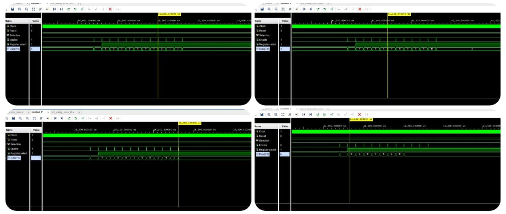
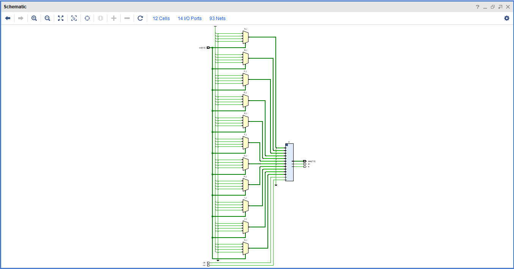

# LCD Display Controller
### RTL Design and Functional Verification Using Verilog HDL

- 🌐 **Live Demo:** [Open LCD Demo](https://team-hanuman.github.io/LCD/)

## 1. Introduction

This project implements an LCD Display Controller using Verilog HDL. It uses a Finite State Machine (FSM), Counter, and Multiplexer to select and display predefined messages.

## 2. Objectives

- Design an LCD controller using Verilog HDL.
- Select four messages using a 2-bit input.
- Generate timing signals using FSM and Counter.
- Transfer 8-bit ASCII data to the LCD.
- Verify the design using Xilinx Vivado.

## 3. Message Selection

| Selection | Display Message |
|:---:|---|
| 00 | HANUMAN |
| 01 | VIBHISHANA |
| 10 | PARASHURAMA |
| 11 | KRIPAVYALI |

## 4. System Architecture

The project consists of two main modules:

**LCD Controller Module**
- Controls LCD operations.
- Uses FSM and Counter for timing.
- Generates EN, RS, and DATA[7:0] signals.

**Message Selection MUX Module**
- Accepts a 2-bit selection input.
- Selects one of four predefined messages.
- Provides character data to the LCD controller.

## 5. FSM Operation

The controller uses 18 states (0–17):

- State 0: Power-up delay.
- States 1–6: LCD initialization and waiting.
- States 7–17: Transfer eleven character positions.

## 6. Simulation Results

The simulation is performed using Xilinx Vivado to verify message selection, data transfer, and control signal activity.

### Simulation Waveform

## 7. RTL Schematic

The RTL schematic represents the hardware structure and connections between the design modules.

### RTL Schematic Diagram

## 8. Results

| Parameter | Result |
|---|---:|
| Total Cells | 12 |
| I/O Ports | 14 |
| Nets | 93 |

Simulation waveforms demonstrate selection-dependent data transfer activity.

## 9. Applications

- Embedded systems.
- FPGA-based display systems.
- Digital information boards.
- Electronic display devices.
- LCD interfacing experiments.

## 10. Future Enhancements

- Support 16×2 LCD displays.
- Add scrolling messages.
- Improve LCD initialization and RS control.
- Implement continuous display operation.
- Verify using physical FPGA hardware.

## 11. Conclusion

This project demonstrates LCD message selection and data transfer using Verilog HDL. It combines FSM, Counter, and Multiplexer concepts and verifies the RTL design using Xilinx Vivado.

---

## Team Hanuman

**Project Team Members**

1. Likitha Paidi
2. Priya Nageswari Karanam
3. Gayatri Galidevara
4. Durga Umesh Arige
